# GnssView UI 全量审计报告 (UI Audit)

**审计日期**: 2026-11-16  
**Qt 版本**: Qt 6.11.2 (GCC 16.2.1, Linux Wayland, Fedora)  
**构建系统**: CMake 3.24+ / Ninja  
**基线分支**: `master` (commit `0a04617`, Tag `V0.1.5`)  
**作业分支**: `feature/ui-modernization`  

---

## 1. 工程概况与模块结构

GnssView 是一款基于 Qt Quick / QML 的高信息密度跨平台专业 GNSS 接收机与测试监控桌面应用。

### 1.1 构建入口与依赖
- **C++ 入口**: `app/main.cpp`
  - 设置 Controls 样式：`QQuickStyle::setStyle("Basic")`
  - 核心单例/上下文注入：
    - `appSettings` (`hdgnss::AppSettings`)
    - `appController` (`hdgnss::AppController`)
    - `updateChecker` (`hdgnss::UpdateChecker`)
    - `transportViewModel` (`hdgnss::TransportViewModel`)
    - `rawLogModel`, `satelliteModel`, `signalModel`, `commandButtonModel`, `deviationMapModel`, `tecMapOverlayModel`, `autoTestController`
  - 字体注入：`uiBodyFontFamily`, `uiMonoFontFamily`
  - 加载 QML 入口：`qml/Main.qml`
- **构建脚本**: `CMakeLists.txt`
  - 支持 Qt6 组件: `Core`, `Gui`, `Qml`, `Quick`, `QuickControls2`, `Network`, `SerialPort`, `Widgets`
  - QML 部署机制：通过 `add_custom_target(GnssViewRuntimeAssets)` 将 `${CMAKE_CURRENT_SOURCE_DIR}/src/ui/qml` 同步复制至构建目录 `${TARGET_FILE_DIR}/qml`

### 1.2 QML 文件清单 (共 16 个主文件)
| 文件路径 | 职责 | 行数 | 状态 / 发现 |
|---|---|---|---|
| `src/ui/qml/Main.qml` | 主窗口 Shell、顶栏控制、网格仪表板布局、更新弹窗 | 750 | Frameless 自绘标题栏，非 macOS 无 MenuBar，窗口最小限制 1280x720 |
| `src/ui/qml/components/Theme.qml` | 设计 Token 入口、暗黑/明亮颜色、GNSS 领域语义色 | 313 | 被每个文件单独实例化，未集中化；多平台字体回退待优化 |
| `src/ui/qml/components/NeonButton.qml` | 发光/渐变风格通用按钮 | 83 | **严重问题**：`visualAccent` 强行覆盖调用者传入的 `accent`，语义色失效 |
| `src/ui/qml/components/NeonTabBar.qml` | 顶部 Tab 栏容器 | 41 | 仅用于 Tab 栏，依赖 `NeonTabButton` |
| `src/ui/qml/components/NeonTabButton.qml` | Tab 项控件 | 72 | 状态动画与下边框强调 |
| `src/ui/qml/components/GlassPanel.qml` | 面板通用毛玻璃/发光卡片背景底座 | 69 | 为所有 Dashboard 面板提供卡片外观与标题栏 |
| `src/ui/qml/components/SettingsPanel.qml` | 设置中心弹窗（外观、日志、插件表单、应用配置） | 1017 | **严重问题**：超千行单文件，内嵌 10+ 重复控件，键盘/焦点支持不足 |
| `src/ui/qml/components/TransportConfigPanel.qml` | 通信端口设置面板 (UART / TCP / UDP / 插件) | 1290 | 自行定义 `DenseLabel/DenseTextField/DenseComboBox`，内联动态插件加载器 |
| `src/ui/qml/components/DataPanel.qml` | GNSS 导航数值、定位状态、NMEA/Bin 原生数据流 | 496 | 自行定义 `StatLabel/StatValue/MetricCard/ContentFrame` |
| `src/ui/qml/components/SkyViewPanel.qml` | 卫星天空图 (Canvas 极坐标绘制) | 269 | Canvas 极坐标图表，主题切换时需确保重绘 |
| `src/ui/qml/components/SignalBarsPanel.qml` | 载噪比/信号柱状频谱图 | 288 | 频段切换 (L1/L2/L5/B1/B2/B3/E1/E5 等) 与条形图渲染 |
| `src/ui/qml/components/CommandButtonsPanel.qml` | GNSS 交互控制台与指令发送按钮 | 185 | 自行定义 `DenseLabel/DenseTextField/DenseComboBox` |
| `src/ui/qml/components/WorldLocationPanel.qml` | 2D 世界地图定位与 TEC 电离层覆盖图 | 509 | 支持 Canvas 地图投影与 TEC 实时渲染叠加层 |
| `src/ui/qml/components/DeviationMapPanel.qml` | 散落点/偏差散点图 | 239 | 自行定义 `StatLabel/StatHeader` |
| `src/ui/qml/components/AutoTestPanel.qml` | 自动化测试插件面板 | 84 | 动态实例化外部 AutoTest 插件 QML |
| `src/ui/qml/components/InstrumentToolTip.qml` | 定制仪表悬浮提示框 | 52 | 自定义 ToolTip 视图 |

---

## 2. 引用关系与依赖拓扑

```mermaid
graph TD
    Main[Main.qml] --> Theme[Theme.qml]
    Main --> SettingsPanel[SettingsPanel.qml]
    Main --> UpdateDialog["Popup: updateDialog"]
    Main --> TransportConfigPanel[TransportConfigPanel.qml]
    Main --> DataPanel[DataPanel.qml]
    Main --> SkyViewPanel[SkyViewPanel.qml]
    Main --> CommandButtonsPanel[CommandButtonsPanel.qml]
    Main --> AutoTestPanel[AutoTestPanel.qml]
    Main --> WorldLocationPanel[WorldLocationPanel.qml]
    Main --> DeviationMapPanel[DeviationMapPanel.qml]
    Main --> SignalBarsPanel[SignalBarsPanel.qml]

    SettingsPanel --> Theme
    SettingsPanel --> NeonButton[NeonButton.qml]
    SettingsPanel --> InlineSettingsControls["Inline Components: DenseField / CheckBox / ThemeChoice / PluginCard / PluginComboBox"]

    TransportConfigPanel --> GlassPanel[GlassPanel.qml]
    TransportConfigPanel --> NeonButton
    TransportConfigPanel --> NeonTabBar[NeonTabBar.qml]
    TransportConfigPanel --> InlineTransportControls["Inline Components: DenseTextField / DenseComboBox / CustomPluginUi"]

    DataPanel --> GlassPanel
    DataPanel --> NeonTabBar
    DataPanel --> InlineDataControls["Inline Components: MetricCard / StatValue / ContentFrame"]

    CommandButtonsPanel --> GlassPanel
    CommandButtonsPanel --> NeonButton
    CommandButtonsPanel --> InlineCmdControls["Inline Components: DenseTextField / DenseComboBox"]

    AutoTestPanel --> GlassPanel
    WorldLocationPanel --> GlassPanel
    DeviationMapPanel --> GlassPanel
    SignalBarsPanel --> GlassPanel
    SkyViewPanel --> GlassPanel
```

---

## 3. 核心问题分级与风险清单

### P0 (阻断 / 语义错误 / 严重缺陷)
1. **`NeonButton` 语义强调色完全失效**:
   - `NeonButton.qml` 声明了 `property color accent: theme.accent`，但视觉渲染属性为 `readonly property color visualAccent: theme.tabSelectedAccent`。
   - 所有调用者传入的 `accent: theme.ok`（如 Open/Download）、`accent: theme.bad`（如 Close/Later）在界面上全部被覆盖为同一强调色，危险操作和成功操作无法从颜色上区分。
2. **非 macOS 平台缺乏系统菜单可发现性**:
   - `Main.qml` 中 `menuBar: window.isMac ? macMenuBar : null`。Windows 与 Linux 用户在界面上只能通过标题栏齿轮进入 Settings，缺乏标准快捷键和菜单入口（如 Preferences, Check for Updates, About, Quit 等），不符合桌面规范。
3. **`tests/qml/tst_GenericTransport.qml` 基线测试失败**:
   - 在上游 commit `56b5a49` 引入的 `tst_GenericTransport.qml`，因动态创建 QML 对象的 ID 作用域或 Repeater 内部按钮查找机制，在 `compare(pluginOpen().enabled, true)` (line 60) 处报错断言失败。此属于基线已存缺陷，需予以标记并安全修复。

### P1 (高优先级 / 架构与一致性缺陷)
1. **基础控件极度重复与散落**:
   - `DenseTextField` / `DenseField` 在 `SettingsPanel`、`TransportConfigPanel`、`CommandButtonsPanel` 中重复定义了 3 遍。
   - `DenseComboBox` / `PluginComboBox` 重复定义了 3 遍。
   - `DenseLabel` / `FieldLabel` / `StatLabel` 重复定义了 5 遍。
   - `CheckBox` 样式在 `SettingsCheckBox` 与 `PluginFieldCheckBox` 中重复。
   - 导致全局没有统一的 Focus 焦点框、禁用态背景、校验错误状态和键盘交互。
2. **`SettingsPanel.qml` 巨型单文件 (1017 行)**:
   - 集成了外壳 Popup、滚动容器、外观切换、日志配置、多插件动态表单生成（包含文本、密码、枚举、布尔、只读校验）、偏好设置持久化。
   - 组件未拆分，修改易引起连带破坏。
3. **Frameless 标题栏窗口管理风险**:
   - Windows/Linux 采用 `FramelessWindowHint` 自绘标题栏，虽然实现了 `startSystemMove` / `startSystemResize`，但双击最大化、多屏边界、窗口吸附、分屏 Snap 在部分 Linux 桌面环境存在边缘触发困难或负坐标多屏拉伸异常。

### P2 (中优先级 / 体验与无障碍)
1. **Theme 实例泛滥与性能开销**:
   - 每个 QML 面板、甚至单个 Button 内部都独立创建一个 `Theme { id: theme }`，共计 15+ 处实例，缺乏轻量化或 Singleton 机制。
2. **键盘导航与无障碍缺失**:
   - 大量按钮与卡片基于纯 `Rectangle + MouseArea` 实现，无 `activeFocusOnTab`、无 `Accessible` 角色声明、无键盘 Enter/Space 触发。
3. **小分辨率与高 DPI 适应局限**:
   - `Main.qml` 硬编码 `minimumWidth: 1280, minimumHeight: 720`，在 100% 缩放下刚好可用，但在 1366x768 或高 DPI 缩放下若窗口较小，弹窗可能超出屏幕边界。

### P3 (低优先级 / 细节与性能)
1. **Canvas 主题重绘联动**:
   - 某些 Canvas（如 `Main.qml` 背景网格、`SkyViewPanel`）依赖 `onWidthChanged/onHeightChanged` 触发 `requestPaint()`，在运行时主题切换时未显式监听 `theme.lightMode` 重新绘制。
